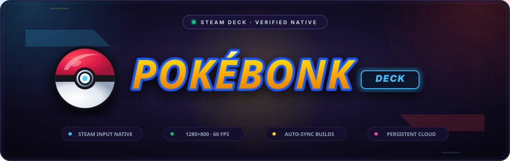
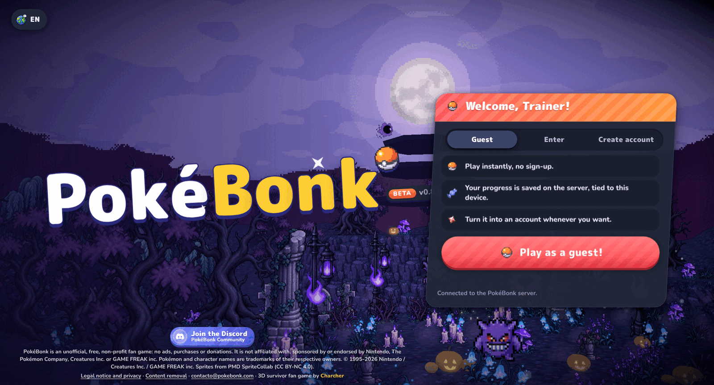
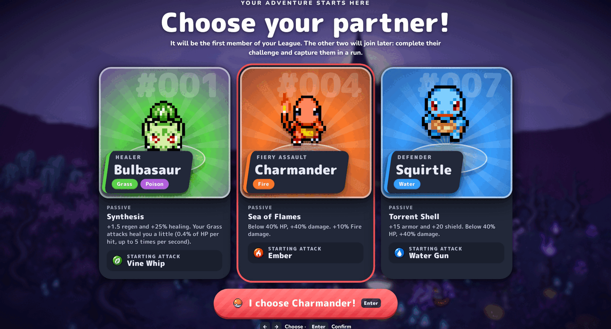
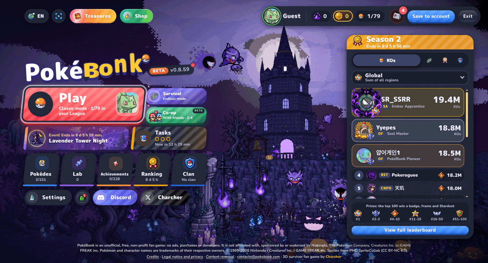
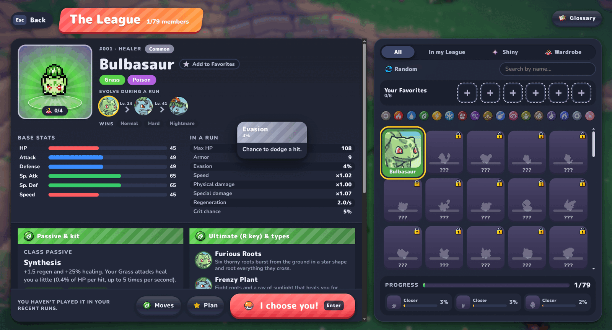
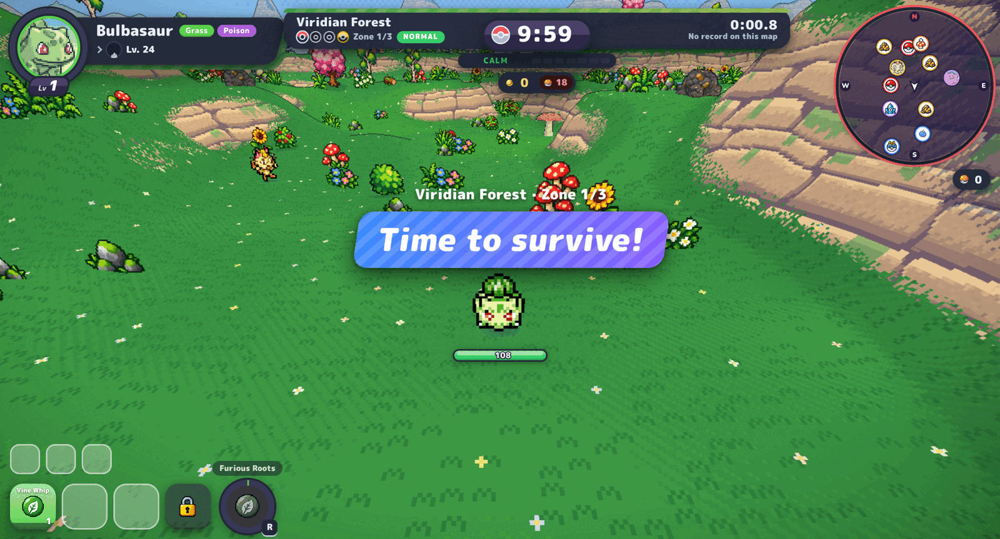

<div align="center">



# PokéBonk Deck

**The browser game, as a real app on Steam Deck.**

[](https://github.com/NaustudentX18/pokebonk-deck/releases/latest)
[](https://naustudentx18.github.io/pokebonk-deck/)
[](https://github.com/NaustudentX18/pokebonk-deck)
[](https://www.electronjs.org)
[](LICENSE)
[](NOTICE.md)

An unofficial native Linux client for [PokéBonk](https://pokebonk.com) — the free, non-profit
3D Pokémon survivor game by Charcher.

Fullscreen on launch. Controller-native. Saves that persist. Game updates that arrive on their
own. One AppImage, no install, no root.

> **Status: v1.1.0 Released & Hardware Verified.** Tested and proven on Steam Deck (SteamOS 3.6+ OLED & LCD).
> Single-command installer handles Steam library shortcuts, Gamepad input mapping, and Gamemode wrappers automatically.
> Landing page & install guide: **[https://naustudentx18.github.io/pokebonk-deck/](https://naustudentx18.github.io/pokebonk-deck/)**

</div>

---

## Why this exists

PokéBonk ships as a website. That's the upstream's choice and this project respects it — **no
game assets, art, music or saves are redistributed here.** The client simply loads the live
site as a top-level document and puts a console-shaped shell around it.

| In a browser tab | In PokéBonk Deck |
|---|---|
| Address bar, tabs, scrollbars | Kiosk fullscreen at 1280×800 |
| Touch/emulated input on a Deck | Real Gamepad API — the game's own layouts, glyphs, remapping and rumble |
| `localStorage` cleared by "clear site data" | Persistent Chromium profile — session and guest id survive restarts |
| You find out about a new build when the page tells you | The client polls `version.json` out-of-process and reloads when the build id changes |
| Page reloads lose your place | The shell reloads cleanly, tearing down the WebGL context first |

## Screenshots

| Title | Partner select |
|---|---|
|  |  |

| Hub | League / Pokédex |
|---|---|
|  |  |

**Live gameplay**, recorded from the running game:



<sub>Video: <a href="site/media/gameplay.mp4">gameplay.mp4</a> · captured from the live game.</sub>

## Install

One command, on any x86-64 Linux — including the Steam Deck's Desktop Mode terminal:

```bash
curl -fsSL https://github.com/NaustudentX18/pokebonk-deck/releases/latest/download/install.sh | bash
```

That downloads the latest AppImage, verifies its sha512 against the published manifest,
installs it to `~/.local/share/pokebonk-deck/pokebonk-deck.AppImage`, writes a `.desktop`
entry, drops the launcher icon in place, and **adds the game to your Steam library** so it
shows up in Game Mode with the controller already configured. Re-running it upgrades in
place.

What it sets up on the Deck:

| | |
|---|---|
| Steam library entry | so it appears in the library and in Game Mode |
| Steam Input | pointed at the neptune **gamepad** layout, not the Desktop Layout |
| Resolution | `1280x800`, the Deck's native panel |
| Launch | a wrapper that uses gamemode when it is available and falls back when it is not |

> Steam Input cannot be disabled for the Deck's built-in controller — the correct fix is
> the Gamepad action set, which the installer selects for you.

<details>
<summary>Manual install</summary>

1. Download `PokebonkDeck-1.1.0-x86_64.AppImage` from the [releases page](https://github.com/NaustudentX18/pokebonk-deck/releases).
2. Make it executable:
   ```bash
   chmod +x ~/Downloads/PokebonkDeck-1.1.0-x86_64.AppImage
   mkdir -p ~/.local/share/pokebonk-deck
   mv ~/Downloads/PokebonkDeck-1.1.0-x86_64.AppImage ~/.local/share/pokebonk-deck/
   ```
3. In Steam: **Library → Add a Non-Steam Game** → browse to the AppImage. Set the launch
   option to `gamemoderun %command%`.

> Keep the AppImage on internal storage. The self-updater replaces the file in place, and a
> rename across filesystems (e.g. FAT32 on the microSD card) fails.

</details>

<details>
<summary>Steam Deck notes</summary>

SteamOS already ships every library the AppImage needs; the Chromium sandbox works through
unprivileged user namespaces, so there is no `--no-sandbox` and no root.

Add it to Steam as a non-Steam game with the launch option `gamemoderun %command%`, and use
Steam Input's **Gamepad** action set — Steam Input cannot be disabled for the Deck's built-in
controller, and Desktop Layout would send mouse/keyboard instead.

</details>

## Uninstall

One command, and the machine is back exactly as it was before:

```bash
curl -fsSL https://github.com/NaustudentX18/pokebonk-deck/releases/latest/download/uninstall.sh | bash
```

It removes the app, the desktop entry, the icon, the app's state, the Steam
shortcut, the `localconfig.vdf` block, the per-title Steam Input entry and the
capsule artwork. Everything else in your Steam library is left alone, and
`shortcuts.vdf` and `localconfig.vdf` are backed up first.

> Quit the Steam client before running it — the client keeps the shortcut list
> in memory and rewrites `shortcuts.vdf` on exit, which would put the
> shortcut back.

## How updates work

Two independent channels:

| What updates | How | Cadence |
|---|---|---|
| **The game** | The client fetches `https://pokebonk.com/version.json` from the main process (the endpoint sends no CORS header, so it must be out-of-process), compares the `build` id against the last one it saw, and reloads the webview with `?v=<build>` — mirroring the game's own teardown: stop the animation loop, dispose the renderer, force context loss, then navigate. | Whenever Charcher ships. Upstream moves fast; v0.6.3 → v0.8.59 in eight days. |
| **The client** | `electron-updater`'s `AppImageUpdater` polls the GitHub release channel, downloads a differential update using the block map embedded in the AppImage, and replaces the running file atomically on next launch. Requires `APPIMAGE` to be set — i.e. launch the `.AppImage` itself, not an unpacked directory. | When this project ships a fix. |

## Controls

The game's own defaults, read from the shipped build. The in-game remap screen still works.

| Action | Keyboard | Controller & Steam Deck |
|---|---|---|
| Move | `W` `A` `S` `D` | Left stick / D-pad |
| Jump | `Space` | A / Cross |
| Dash (air dive) | `Shift` | B / Circle |
| Interact | `E` | X / Square |
| Ultimate | `R` | Y / Triangle |
| Lock target | Middle mouse | Right trigger (R2) |
| Auto aim | `Q` | Left trigger (L2) |
| Auto-run | `T` | Left stick click (L3) / L4 grip paddle |
| Big map | `M` | Select / View button (Back) |
| Auto ultimate | `Y` | Right stick click (R3) / R4 grip paddle |
| Pause | `P` | Start / Menu |
| Reroll upgrade | `F` | X / Square |
| Skip upgrade | `X` | Y / Triangle |
| Banish upgrade | `Z` | Right bumper (R1) |

The game detects three controller layouts — `std`, `xlinux` and `generic`. The Steam Deck's
controller lands on the `xlinux` path, which is the branch the game was built to handle.

### Shell shortcuts

| Shortcut | Action |
|---|---|
| `F10` | Open the shell menu |
| `Esc` | Resume from the shell menu |
| `F11` | Toggle fullscreen |
| `F5` | Reload the game |
| `F8` | Controller status |
| `Ctrl+Q` | Quit |

## Tips & tricks

- **Bind the right stick early.** The game ships a stick-direction learning wizard that stores
  your camera mapping per controller. Do it once, on the first run.
- **Pick the passive, not the sprite.** Bulbasaur heals on Grass hits, Charmander gets a
  damage spike below 40% HP, Squirtle trades damage for armour and shield.
- **Hold the ultimate for the boss.** Every Pokémon has its own ultimate type — Bulbasaur's
  Furious Roots and Frenzy Plant are crowd-clearers. Auto-ultimate exists, but a saved
  ultimate is usually worth more.
- **Learn the draft shortcuts.** `F` rerolls, `X` skips, `Z` banishes an upgrade — all one
  button each on a controller.
- **Use auto-run and the big map.** `T` toggles auto-run, `M` opens the large map. Farm with
  auto-run, then plan the next route.
- **Deck hygiene.** `gamemoderun %command%` as the Steam launch option; keep the AppImage on
  internal storage, not the SD card.

## Troubleshooting

**No controller in the game.** Chromium only reports a gamepad after the user has interacted
with one — press a button once the game is up. If it still doesn't appear: check that Steam
Input is on a **Gamepad** layout (not Desktop), and that you are running the native Linux build
(a Proton/Windows build is a different code path). `F8` in the shell prints what the client
sees.

**"Your browser is not using your graphics card."** The game detects software rasterisers. On
the Deck this means the GPU isn't being used — check that the app is not running with
`--disable-gpu` and that SteamOS's Mesa drivers are intact.

**Saves vanished.** Saves live in `localStorage` on the `https://pokebonk.com` origin inside
the client's persistent profile. If you launched a different build (unpacked directory, `deb`,
a different partition), you get a different profile.

**A new game build didn't load.** The client reloads automatically within its check interval.
Force it with `F5`.

More in [docs/troubleshooting.md](docs/troubleshooting.md).

## Docs

| Guide | |
|---|---|
| [docs/install.md](docs/install.md) | Steam Deck, desktop Linux, launch options, Flatpak notes |
| [docs/controls.md](docs/controls.md) | Full control map, controller layouts, remapping |
| [docs/troubleshooting.md](docs/troubleshooting.md) | Controllers, rendering, saves, updates |
| [docs/superpowers/specs/2026-10-27-pokebonk-deck-design.md](docs/superpowers/specs/2026-10-27-pokebonk-deck-design.md) | Design spec — the verified evidence behind every decision |
| [docs/superpowers/plans/2026-10-27-pokebonk-deck.md](docs/superpowers/plans/2026-10-27-pokebonk-deck.md) | Implementation plan |

## Building from source

```bash
npm ci
npm start          # run against the live game
npm test           # unit tests
npm run build      # -> dist/PokebonkDeck-1.0.0-x86_64.AppImage
./scripts/verify-build.sh   # asserts the static, FUSE3-free runtime and no forced --no-sandbox
```

Requirements: Node 20+. No native compilation, no system packages, no root.

## Legal

PokéBonk Deck is an **unofficial community client**. It is not affiliated with, sponsored by,
or endorsed by the creator of PokéBonk (Charcher) or by Nintendo, The Pokémon Company,
Creatures Inc. or GAME FREAK inc. Pokémon and related names and images are trademarks of their
respective owners.

PokéBonk is an unofficial, free, non-profit fan game. This project provides a client for the
publicly available website and redistributes **no game assets**. Gameplay imagery in this
repository is captured from the public game for identification and demonstration purposes.

See [NOTICE.md](NOTICE.md).

## License

MIT — see [LICENSE](LICENSE).
